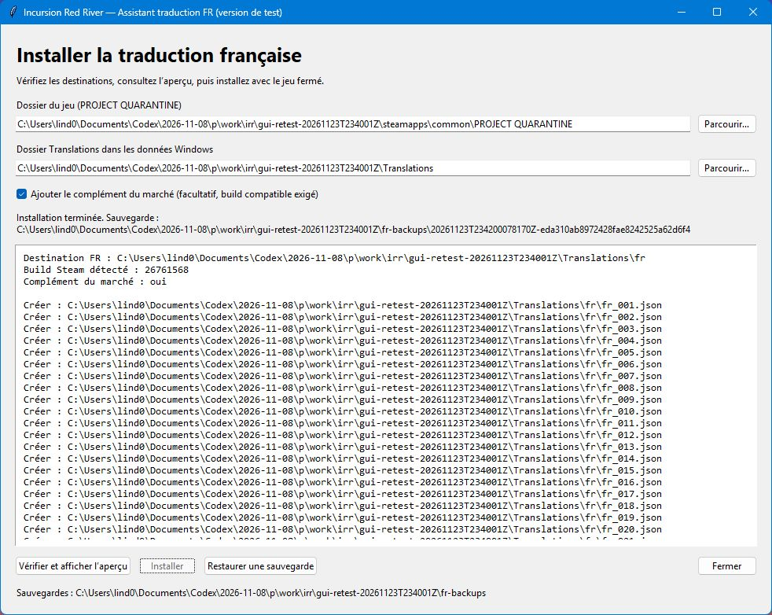

# Incursion Red River — Traduction française

## Guides Steam

**Deux méthodes au choix : installation manuelle ou assistant facultatif.** [Détail de l’assistant FR](installation/README.md) · [Interface et diagnostic AZERTY](azerty/README.md) · [Outils de maintenance](maintenance/README.md).

[Guide de la traduction FR](https://steamcommunity.com/sharedfiles/filedetails/?id=3835740541) · [Guide du préréglage AZERTY](https://steamcommunity.com/sharedfiles/filedetails/?id=3844936408)

Les deux compléments sont indépendants et disposent chacun de leur téléchargement et de leur formulaire de signalement.

## Mise à jour du patch majeure

**Version 0.2.2 bêta — 24 novembre 2026.** Pour **Incursion Red River 1.4.0.4**, build Steam **26761568**.

La 0.2.2 ajoute l’assistant d’installation et les contrôles de maintenance. Les textes et le complément du marché restent identiques à la 0.2.1 : ses 240 corrections sont incluses. Elle conserve la traduction des catégories, des filtres et des chemins de catégories ajoutée en 0.2.0. Un glossaire protège les noms du jeu, des cartes et les appellations commerciales.

**J’ai vérifié les fenêtres, les aperçus, l’installation et la restauration des deux assistants sur des copies. Le refus d’un build incompatible fonctionne aussi.** La traduction et les 13 touches AZERTY avaient déjà été essayées en jeu ; je n’ai pas refait de partie pour cette mise à jour des assistants. Des tests approfondis restent à faire. La bêta n’est pas une validation de tous les objets, des achats/ventes, du marché noir ou de toutes les missions.

[Télécharger la 0.2.2 bêta](https://github.com/ikkinomi/incursion-red-river-fr/releases/download/v0.2.2-beta/Incursion_Red_River_FR_1.4.0.4_v0.2.2-beta.zip) · [Voir la publication](https://github.com/ikkinomi/incursion-red-river-fr/releases/tag/v0.2.2-beta) · [Signaler un bug ou une erreur de traduction](https://github.com/ikkinomi/incursion-red-river-fr/issues/new?template=correction.md)

## Deux téléchargements indépendants

| Téléchargement | Utilité |
|---|---|
| [Traduction FR 0.2.2 bêta](https://github.com/ikkinomi/incursion-red-river-fr/releases/tag/v0.2.2-beta) | Textes français et complément facultatif du marché |
| [Préréglage AZERTY 0.2.0 bêta](https://github.com/ikkinomi/incursion-red-river-fr/releases/tag/azerty-v0.2.0-beta) | Commandes françaises et rangée numérique, en gardant Windows en français |

L’AZERTY n’est pas inclus dans l’archive FR. Il ne nécessite pas la traduction. [Fonctionnement, sauvegarde et installation AZERTY](azerty/README.md).

## Ce que contient l’archive

- **`fr/`** : la traduction communautaire habituelle, à placer dans le dossier de traductions de Windows.
- **`Test_C/Content/Paks/pakchunk98-FrenchMarketTest_P.pak`** : le nouveau complément d’affichage du marché, à placer dans le dossier du jeu. Il reste facultatif : sans lui, la traduction JSON fonctionne, mais certaines catégories du marché restent en anglais.

**Les deux dossiers vont à des endroits différents.** Extraire le ZIP ne suffit pas à installer le patch.

## Installation ou mise à jour

Fermez le jeu avant toute modification. Le même ZIP FR permet de choisir entre les deux méthodes ci-dessous. Il n’est pas nécessaire de les cumuler.

### Méthode A — Avec l’assistant

1. Installez une version maintenue de [Python pour Windows](https://www.python.org/downloads/windows/), avec Tcl/Tk. Python 3.11 ou plus récent conseillé ; aucune bibliothèque supplémentaire.
2. Téléchargez le ZIP FR et extrayez **tous ses fichiers** dans un dossier indépendant du jeu et de Translations.
3. Ouvrez **INSTALLER-FR.cmd**.
4. Vérifiez les chemins proposés. L’assistant cherche le jeu dans les bibliothèques Steam et préremplit le dossier Translations du compte Windows. Si plusieurs installations sont trouvées, ou aucune, utilisez **Parcourir…**.
5. Cochez le complément du marché si souhaité. Il est accepté seulement pour le build Steam validé.
6. Cliquez sur **Vérifier et afficher l’aperçu**, lisez les fichiers concernés, puis **Installer** et confirmez.
7. Lancez le jeu vous-même et choisissez Français.

Les vérifications et l’aperçu n’écrivent rien dans le jeu. Les fichiers remplacés sont sauvegardés avant la copie dans `%LOCALAPPDATA%/Test_C/FR-Backups`. **Restaurer une sauvegarde** permet de choisir une transaction précédente ; un fichier modifié depuis cette installation est protégé contre l’écrasement. [Fonctionnement détaillé](installation/README.md).

*Les captures viennent des essais sur des copies : leurs chemins sont ceux du dossier de test. Sur votre PC, vérifiez les destinations proposées.*

### Méthode B — Installation manuelle, sans Python

La procédure ci-dessous reste disponible. Les scripts de l’assistant ne sont pas nécessaires pour copier les fichiers à la main.

#### 1. Fermer le jeu et désactiver l’ancien patch .pak

Si le jeu n’a jamais été lancé, lancez-le une première fois pour qu’il crée son dossier de traductions, puis fermez-le.

Dans Steam, ouvrez **Incursion Red River → Propriétés → Fichiers installés → Parcourir**, puis `Test_C/Content/Paks`.

Si vous avez encore **`pakchunk99-French_P.pak`**, renommez uniquement ce fichier en **`pakchunk99-French_P.pak.disabled`**, ou déplacez-le dans un dossier de sauvegarde hors du jeu. Il appartient aux anciens patchs et doit rester désactivé. Conservez les archives d’origine du jeu.

#### 2. Installer la traduction JSON

1. Téléchargez et extrayez le ZIP de la 0.2.2.
2. Ouvrez l’Explorateur de fichiers, collez **`%LOCALAPPDATA%\Test_C\Saved\Translations`** dans sa barre d’adresse, puis validez.
3. Si un dossier `fr` existe déjà, faites-en une copie de sauvegarde **en dehors de `Translations`**.
4. Copiez le dossier **`fr`** de l’archive dans `Translations`. Si Windows le demande, remplacez les fichiers du patch précédent.
5. Vérifiez le résultat : **`Translations/fr/fr_001.json`**, avec les autres fichiers JSON à côté. Il ne doit pas y avoir de dossier `fr/fr`.

Depuis la 0.1.8 ou la 0.1.9, la procédure est la même. Les 36 fichiers JSON contiennent les 240 corrections de la 0.2.1. Depuis la 0.2.1, les textes et le complément du marché sont identiques ; l’assistant est la nouveauté. Remplacez également le complément du marché si vous l’utilisez.

#### 3. Ajouter le complément du marché

1. Retournez dans le dossier du jeu ouvert depuis Steam : `PROJECT QUARANTINE`.
2. Ouvrez **`Test_C/Content/Paks`**.
3. Copiez-y **`pakchunk98-FrenchMarketTest_P.pak`**, qui se trouve au même chemin dans l’archive.
4. Si vous utilisiez déjà ce complément de test, remplacez uniquement ce fichier, jeu fermé.

Résultat attendu : **`PROJECT QUARANTINE/Test_C/Content/Paks/pakchunk98-FrenchMarketTest_P.pak`**.

Ce fichier est le nouveau complément vérifié pour le build indiqué. **Il ne faut pas réactiver l’ancien `pakchunk99-French_P.pak`.** Aucun injecteur ni UE4SS n’est nécessaire.

#### 4. Choisir la langue

Lancez le jeu et choisissez **Français** dans **Paramètres → Langue**, puis ouvrez le marché. Le message de démarrage **« Mods are installed »** est normal avec le complément du marché. Il ne constitue pas, à lui seul, une erreur de fichiers corrompus.

## Après une mise à jour du jeu

**Fermez le jeu et désactivez le complément du marché avant de jouer sur un nouveau build**, en renommant `pakchunk98-FrenchMarketTest_P.pak` en `pakchunk98-FrenchMarketTest_P.pak.disabled`. Attendez une nouvelle vérification de compatibilité avant de le réactiver.

Ce complément remplace une petite partie de l’interface et dépend de la version du jeu. La traduction JSON est indépendante et peut rester installée ; le jeu signale les textes à adapter dans `_Report.txt` et `_Todo_*.json`.

## Retrait et diagnostic

- **Retirer seulement le complément du marché :** jeu fermé, renommez `pakchunk98-FrenchMarketTest_P.pak` en `pakchunk98-FrenchMarketTest_P.pak.disabled`. La traduction JSON reste disponible.
- **Retirer toute la traduction :** désactivez le complément, puis déplacez le dossier `fr` hors de `Translations` et choisissez une autre langue.
- **Si le jeu plante :** commencez par désactiver le complément du marché et vérifiez que l’ancien `pakchunk99-French_P.pak` est également désactivé. Si le problème persiste ou si Steam signale des fichiers corrompus, utilisez **Propriétés → Fichiers installés → Vérifier l’intégrité des fichiers du jeu**.

## Ce qui a été vérifié

Le démarrage, le chargement de la base, l’arbre de catégories en français, une sous-catégorie de capots de culasse, le filtre d’un objet, sa fiche, le chemin de catégorie, la recherche de compatibilité et le retrait de ce filtre ont été vérifiés lors du premier essai. Aucun incident ciblant les widgets modifiés ni erreur fatale/de sérialisation n’a été relevé dans le journal de ce contrôle. J’ai testé le patch et tout semble bien fonctionner.

Les données d’objets et les fonctions sans lien avec les changements d’affichage sont conservées. Les identifiants utilisés par les filtres et les achats ne sont pas renommés. Les règles de relecture préservent Incursion Red River, les noms des cartes, les marques et les modèles. [Glossaire et cas ambigus](docs/GLOSSAIRE.md).

**À approfondir :** achats/ventes et panier, marché noir, saisie dans la recherche, changement de langue et ensemble des objets. Certaines traductions héritées restent maladroites ou en anglais ; les libellés longs peuvent être coupés dans les petits filtres. Les en-têtes d’inventaire, certains titres de commandes, « Joinability » et « RANDOM » restent hors du périmètre de ce complément.

[Détail des vérifications et des limites](docs/VALIDATION.md).

## Signaler un bug ou une erreur de traduction

[**Ouvrir directement le formulaire de signalement sur GitHub**](https://github.com/ikkinomi/incursion-red-river-fr/issues/new?template=correction.md)

Indiquez la version du jeu et du patch, si le complément du marché est installé, l’écran concerné, le texte observé et les étapes pour le retrouver. Une capture et une proposition de correction sont les bienvenues. Un compte GitHub est nécessaire pour envoyer le signalement.

Les fichiers éditables de la traduction native sont dans [`translations/fr`](translations/fr). Conservez `ns`, `key`, `source`, les variables et les balises ; modifiez uniquement `text`. La table `translations/market-display-fr.json` documente les libellés compilés dans le complément et ne se copie pas dans le dossier `fr`.

[Historique](CHANGELOG.md) · [Crédits](CREDITS.md)

Projet communautaire non officiel.

## Suivre les prochaines mises à jour

[Contrôles automatiques](maintenance/README.md) · [28 propositions de libellés courts à vérifier](maintenance/LIBELLES-COURTS.md). Les propositions courtes ne sont pas activées dans cette version. Le modèle anglais reflète le dernier lancement du jeu ; ces contrôles ne remplacent pas un essai en partie.
