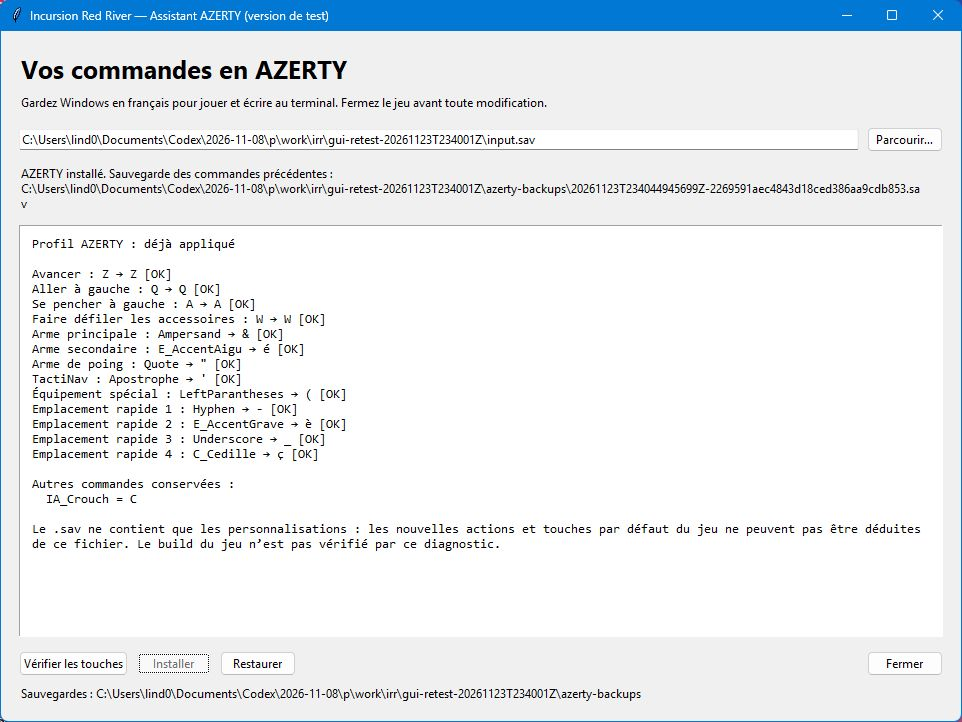
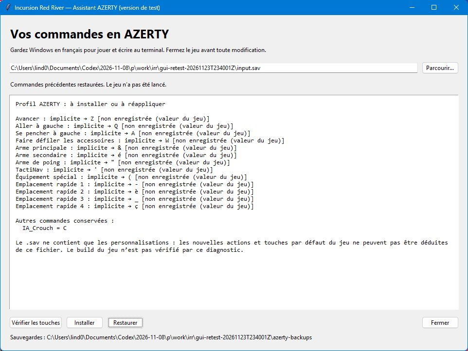

# Incursion Red River — Préréglage AZERTY 0.2.0 bêta

La 0.2.0 ajoute une interface et un diagnostic. Les 13 touches sont identiques à la 0.1.0 déjà essayée en jeu. J’ai vérifié les fenêtres, les confirmations, l’installation et la restauration sur une copie du profil ; je n’ai pas refait de partie pour cette mise à jour de l’outil.

Ce complément permet de jouer avec ZQSD et les touches de la rangée française, tout en gardant Windows en français pour écrire dans le terminal de hack. J’ai testé les déplacements, la saisie au terminal et les raccourcis d’équipement : tout fonctionne bien sur ma configuration.

**Pour Windows et un clavier AZERTY français classique. Vérifié sur Incursion Red River 1.4.0.4 / build 26761568.** Les dispositions belge ou française normalisée récente peuvent avoir une rangée différente.

Il fonctionne indépendamment de la traduction française. [Téléchargement AZERTY](https://github.com/ikkinomi/incursion-red-river-fr/releases/tag/azerty-v0.2.0-beta) · [Traduction française](https://github.com/ikkinomi/incursion-red-river-fr/releases/tag/v0.2.2-beta) · [Signaler un bug](https://github.com/ikkinomi/incursion-red-river-fr/issues/new?template=azerty.md)

## Guides Steam

[Guide de la traduction FR](https://steamcommunity.com/sharedfiles/filedetails/?id=3835740541) · [Guide du préréglage AZERTY](https://steamcommunity.com/sharedfiles/filedetails/?id=3844936408)

Les deux compléments sont indépendants et disposent chacun de leur téléchargement et de leur formulaire de signalement.

## Fonctionnement

L’outil fusionne 13 affectations avec le fichier personnel `EnhancedInputUserSettings.sav`, jeu fermé. Il ne remplace pas votre profil par celui d’un autre joueur. Il conserve les autres personnalisations, y compris les entrées manette ; les 13 actions du préréglage prennent les touches indiquées ci-dessous.

Il n’agit pas sur les caractères saisis dans le terminal. **Gardez la disposition Windows en français.** Le nom interne du profil reste Default Profile ; aucun bouton AZERTY n’est ajouté au menu.

| Action | Touche |
|---|---|
| Avancer / gauche / reculer / droite | Z / Q / S / D |
| Se pencher à gauche / droite | A / E |
| Faire défiler les accessoires tactiques | W |
| Arme principale / secondaire / arme de poing | & / é / " |
| TactiNav / équipement spécial | ' / ( |
| Emplacements rapides 1 à 4 | - / è / _ / ç |

Les touches de la rangée du haut s’utilisent **sans Maj**. S, D et E restent les valeurs d’origine ; le préréglage ne les écrase pas si vous les aviez personnalisées. La touche C, la touche 0 et le pavé numérique ne sont pas modifiés.

## Méthode A — Assistant graphique

1. Installer une version maintenue de **Python 3** pour Windows (Python 3.11 ou plus récent conseillé), depuis [python.org](https://www.python.org/downloads/windows/). Aucune bibliothèque supplémentaire n’est nécessaire.
2. Fermer Incursion Red River. Si aucun profil n’existe encore, lancer le jeu une fois, enregistrer une affectation dans les paramètres, puis le fermer.
3. Télécharger le ZIP **AZERTY**, puis extraire **tous** ses fichiers dans un dossier, en les gardant ensemble.
4. Ouvrir **AZERTY.cmd**, choisir **0 — Interface graphique**, puis **Vérifier les touches**. Lire les touches actuelles, celles proposées, les autres commandes conservées et les conflits éventuels. Le profil du compte Windows est prérempli ; Parcourir permet de choisir une copie ou un autre fichier. Cliquer sur **Installer** et confirmer, avec le jeu fermé. Si les 13 touches sont déjà correctes, Installer reste désactivé.
5. Garder Windows en français, lancer le jeu et tester ZQSD, A/E, W, les neuf raccourcis, puis la saisie d’une commande habituelle au terminal.

Alternative depuis un terminal ouvert dans le dossier extrait : `py -3 azerty.py preview`, puis `py -3 azerty.py install`. Avec une installation sans lanceur py, utiliser `python` à sa place. Aucune exécution en administrateur ni modification de la politique PowerShell n’est demandée.

Le seul fichier modifié est `%LOCALAPPDATA%/Test_C/Saved/SaveGames/EnhancedInputUserSettings.sav`. Le jeu doit être fermé. Les sauvegardes des commandes sont stockées dans `%LOCALAPPDATA%/Test_C/AZERTY-Backups`, en dehors des sauvegardes Steam du jeu.

L’outil s’arrête si le format n’est pas pris en charge, si plusieurs profils sont détectés, si le jeu est ouvert ou si une autre action personnalisée utilise déjà une des touches réservées. Dans ce dernier cas, résoudre le conflit dans les paramètres du jeu, fermer le jeu et réessayer. Une installation répétée sur un profil déjà configuré n’ajoute pas de doublons.

*Les captures montrent un profil de test. Sur votre PC, le chemin correspond à votre compte Windows.*

## Méthode B — Réglage manuel dans le jeu

Vous pouvez régler les commandes vous-même, sans lancer l’outil ni installer Python. Gardez Windows en français et reprenez le tableau des touches dans les paramètres des commandes du jeu. Déplacez d’abord une action qui occupe déjà une touche voulue.

**Je n’ai pas vérifié la capture de chaque caractère français dans le menu d’affectation.** Si une touche de la rangée française est refusée ou ne fonctionne pas en partie, utilisez le préréglage de l’outil : ses neuf raccourcis ont été essayés en jeu. Le fichier .sav est binaire ; ne l’ouvrez pas dans un éditeur de texte pour changer les touches.

## Variante sans interface graphique

Les choix **1 — Aperçu**, **2 — Installer** et **3 — Restaurer** de AZERTY.cmd restent disponibles. Ils utilisent le même outil et nécessitent Python. Ce mode n’est pas un réglage manuel des touches.

`py -3 azerty.py diagnose` affiche le diagnostic. Avec `--json diagnostic-local.json`, il exporte les touches personnalisées : relisez ce rapport avant de le partager.

## Retour arrière

Fermer le jeu et utiliser le bouton **Restaurer** de l’interface, le choix **3** de `AZERTY.cmd`, ou exécuter `py -3 azerty.py restore`. L’outil restaure la sauvegarde correspondant au profil installé et vérifie ses empreintes.

Si le jeu a réécrit le fichier ou si vous avez changé des commandes, la restauration automatique peut refuser pour éviter d’écraser vos modifications. Les sauvegardes restent disponibles : conserver une copie du profil actuel, puis copier la sauvegarde `.sav` voulue depuis AZERTY-Backups vers le dossier SaveGames, sous le nom **EnhancedInputUserSettings.sav**, jeu fermé. Le fichier JSON voisin indique les empreintes et le profil concerné.

Ce retour arrière remet les commandes qui précédaient l’installation de cet outil. Il ne supprime pas des personnalisations AZERTY que vous aviez déjà réalisées avant son utilisation.

## Limites et vérifications

J’ai testé ce profil en jeu sur ma configuration. L’outil public reproduit octet pour octet le profil validé et a passé sept tests, dont installation/restauration sur copies, conservation d’autres commandes et de la manette, refus de conflits, fichiers tronqués et formats non pris en charge. Cela ne garantit pas toutes les configurations Windows.

Pas d’injecteur, de DLL, de macro, de programme résident ni de modification des archives ou de l’exécutable du jeu. Python ne sert qu’à lire et écrire les préférences, puis se ferme. Aucune certification par un fournisseur d’anticheat n’est revendiquée.

Pour un signalement, préciser la version du jeu, le message de l’outil, la disposition Windows et la touche physique concernée. **Ne pas joindre vos sauvegardes complètes.** [Formulaire direct de bug ou de correction](https://github.com/ikkinomi/incursion-red-river-fr/issues/new?template=azerty.md)

Projet communautaire non officiel.

## Après une mise à jour du jeu

Relancez **Vérifier les touches**. Une entrée absente du fichier est une valeur implicite du jeu, pas la preuve qu’une touche ne fonctionne pas. Ce fichier ne permet pas de découvrir toutes les nouvelles commandes ni les valeurs par défaut ; le diagnostic ne vérifie pas le build installé. Le format pris en charge reste exigé et les conflits personnalisés sont refusés.

