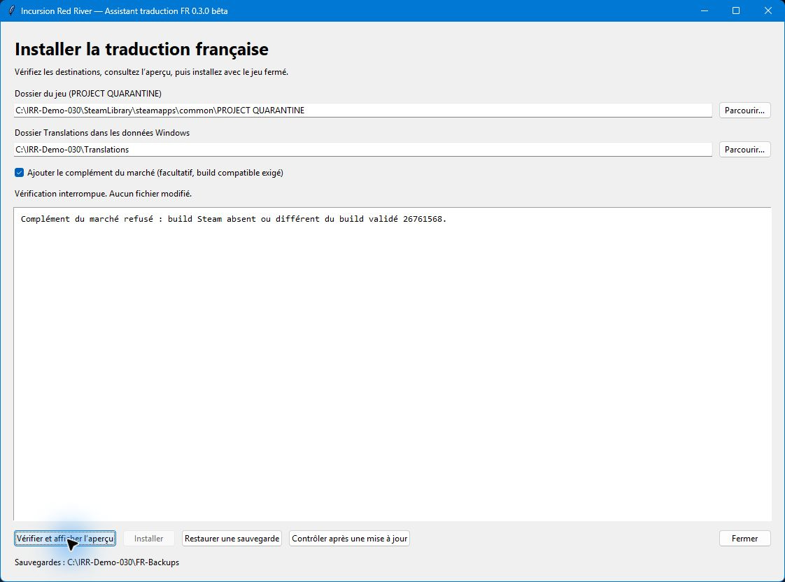

# Assistant FR 0.3.0 bêta

Le ZIP public contient **INSTALLER-FR.exe** : aucun Python à installer pour la fenêtre. Extraire tous les fichiers, fermer le jeu, vérifier les chemins détectés, afficher l’aperçu puis confirmer l’installation. [Procédure complète et méthode manuelle](../README.md#installation-ou-mise-à-jour).

La traduction JSON et le complément facultatif du marché sont séparés. Le complément exige le build Steam 26761568 (jeu 1.4.0.4). Les empreintes et la structure de la traduction sont contrôlées avant la copie. L’ancien pakchunk99 est désactivé si présent, avec sauvegarde et annonce dans l’aperçu.

**Contrôler après une mise à jour** lit les empreintes installées, le build Steam local, le dernier modèle _English et les _Todo disponibles. Il signale un complément actif non validé. Aucun correctif, téléchargement ou lancement du jeu n’est effectué par ce contrôle.

Les fichiers remplacés sont sauvegardés dans `%LOCALAPPDATA%/Test_C/FR-Backups`, avec journal et empreintes. Une interruption tente de remettre les fichiers précédents. **Restaurer une sauvegarde** demande le dossier de transaction et refuse les fichiers modifiés depuis l’installation ; la restauration crée sa propre sauvegarde de retour. Les rapports _Report et _Todo sont conservés. Les dossiers vides créés peuvent rester présents.

Les autres archives du jeu ne sont pas modifiées. Un JSON personnel supplémentaire dans fr doit être sauvegardé hors de ce dossier avant l’installation, pour éviter les doublons d’identités.

## Scripts facultatifs

Python reste nécessaire seulement pour utiliser les sources :

```text
py -3 installation/fr_manager.py gui
py -3 installation/fr_manager.py preview --market
py -3 installation/fr_manager.py check
py -3 installation/fr_manager.py install --market
py -3 installation/fr_manager.py restore --transaction "dossier de sauvegarde"
```

Options : --game, --translations, --source et --backups. La commande install applique directement les changements : utiliser preview avant. Le gestionnaire utilise la configuration Steam locale et ne consulte pas les dernières versions en ligne.




[Guide Steam](https://steamcommunity.com/sharedfiles/filedetails/?id=3835740541) · [Signaler un problème](https://github.com/ikkinomi/incursion-red-river-fr/issues/new?template=correction.md)
