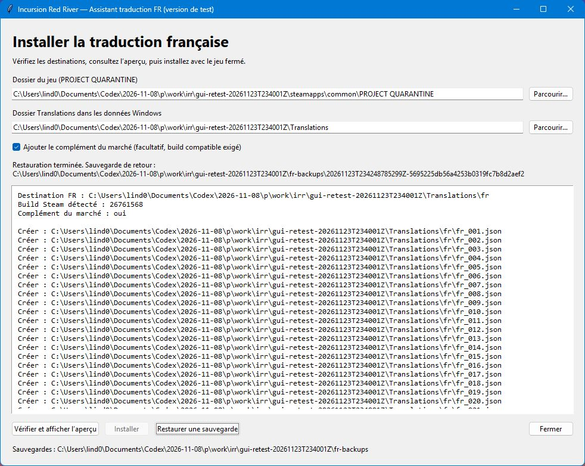

# Assistant d’installation FR — 0.2.2 bêta

Cette version ajoute une installation guidée facultative à la traduction existante, pour Incursion Red River **1.4.0.4 / build Steam 26761568**. Les textes et le complément du marché restent identiques à ceux de la publication 0.2.1. J’ai vérifié la fenêtre, l’aperçu, l’installation et la restauration sur des copies. Le refus d’un build non compatible fonctionne aussi. Un essai complet sur une installation de jeu reste à faire.

Le même ZIP permet aussi [l’installation manuelle, sans Python](../README.md#méthode-b--installation-manuelle-sans-python). Les deux méthodes installent les mêmes fichiers.

## Utilisation

1. Installer une version maintenue de Python 3 avec Tkinter, depuis [python.org](https://www.python.org/downloads/windows/). Python 3.11 ou plus récent conseillé ; aucune bibliothèque à télécharger en plus.
2. Extraire tous les fichiers du ZIP dans un dossier indépendant du jeu et de Translations.
3. Fermer le jeu, puis ouvrir `INSTALLER-FR.cmd`.
4. Vérifier le dossier du jeu détecté dans les bibliothèques Steam et le dossier Windows `Translations`. En cas de plusieurs installations, sélectionner la bonne.
5. Cocher le complément du marché si souhaité. Il est refusé si le build Steam est inconnu ou différent du build validé.
6. Cliquer sur **Vérifier et afficher l’aperçu**, lire les fichiers concernés, puis **Installer** et confirmer.
7. Lancer le jeu soi-même et choisir Français.

La fenêtre ne lance jamais le jeu. Les vérifications et l’aperçu sont en lecture seule. Le profil clavier n’est pas concerné par cet assistant ; le téléchargement AZERTY reste séparé.

L’assistant vérifie les empreintes des sources et leur structure avant la copie. Il conserve les rapports `_Report.txt` et `_Todo_*.json`. Si un fichier JSON personnel supplémentaire est présent dans fr, il demande de le sauvegarder hors de ce dossier pour éviter un doublon d’identités.

Si l’ancien `pakchunk99-French_P.pak` est actif dans le dossier du jeu choisi, l’aperçu annonce sa désactivation. Cette opération et son contenu sont sauvegardés. Les autres archives du jeu sont conservées.

## Sauvegardes et restauration

Avant la copie, les fichiers remplacés sont sauvegardés dans `%LOCALAPPDATA%/Test_C/FR-Backups`, avec un journal et des empreintes. Une installation interrompue tente de remettre les fichiers précédents ; les sauvegardes et le journal restent disponibles si une récupération manuelle est nécessaire.

Pour revenir en arrière, fermer le jeu, cliquer sur **Restaurer une sauvegarde** et sélectionner le dossier de transaction voulu. L’assistant refuse d’écraser un fichier modifié depuis l’installation. La restauration crée elle-même une sauvegarde de retour. Les dossiers vides créés lors d’une installation peuvent rester présents.

Après une mise à jour du jeu, désactiver le complément du marché jusqu’à nouvelle validation. La traduction JSON peut être installée séparément. Le gestionnaire lit le manifeste Steam local ; il ne vérifie pas les dernières versions en ligne.

## Commandes facultatives

Depuis le dossier extrait :

```text
py -3 installation/fr_manager.py preview
py -3 installation/fr_manager.py preview --market
py -3 installation/fr_manager.py install --market
py -3 installation/fr_manager.py restore --transaction "chemin/vers/la/sauvegarde"
```

Options : `--game` pour PROJECT QUARANTINE, `--translations` pour le dossier Translations, `--source` pour fr, `--backups` pour la destination des sauvegardes. La commande `install` applique directement les changements ; utiliser d’abord `preview`.

[Guide Steam FR](https://steamcommunity.com/sharedfiles/filedetails/?id=3835740541) · [Signaler un problème](https://github.com/ikkinomi/incursion-red-river-fr/issues/new?template=correction.md)



Les captures montrent les dossiers de test ; vérifiez les chemins proposés sur votre PC.
